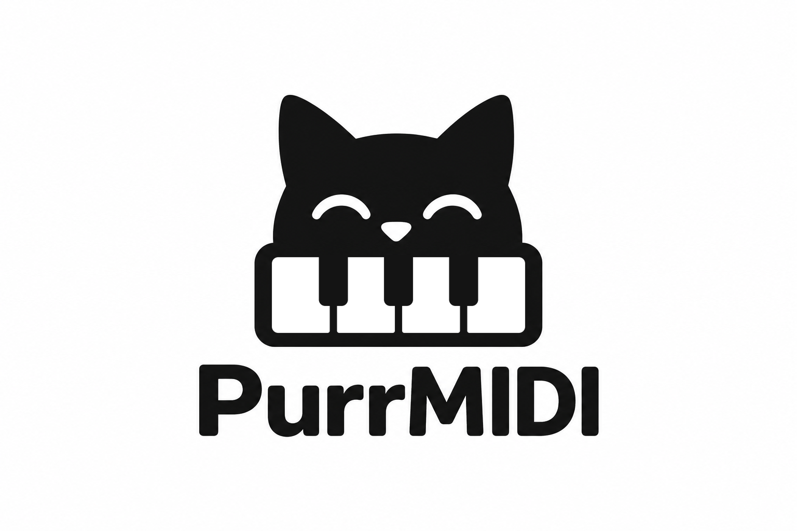

<p align="center">
  
</p>

# PurrMidi

[Русская версия: README_RU.md](README_RU.md)

> **Note:** the technical documentation in `docs/` and the code comments are written in Russian only.

**PurrMidi** is a standalone MIDI synthesizer based on the STM32: connect a USB MIDI keyboard, and the microcontroller generates the sound and outputs it through audio DAC.

The project includes STM32H743 firmware, a Windows application for testing the sound engines on a PC (it can run without a MIDI keyboard), and six sound engines (electric piano, guitar (nylon string), lead, organ, violin, SoundFont).
Hardware and firmware of version 1.0 are complete.

## Hardware

* **Microcontroller:** WeAct STM32H743VIT6 Mini (Cortex-M7).
* **Audio DAC:** PCM5102A.
* **MIDI input:** USB MIDI keyboard via USB OTG.
* **Control button:** the User Key K1 on the microcontroller board, used to switch instruments.
* **Display:** onboard 160×80 ST7735 TFT showing MIDI status, active notes, the chord name and the selected instrument.
* **Memory card:** microSD (FAT32). It is used **only at startup**, to automatically write/update the SoundFont bank `0:/SNDFNT.SF2` into the board's Flash. The SD card is not needed or used during play.

Connections and pinout: [docs/HARDWARE.md](docs/HARDWARE.md) (in Russian).

## Basic operation

**Connecting.** Plug the USB MIDI keyboard into the board's USB OTG connector (the device works as a USB Host) and connect the PCM5102A audio output to an amplifier or headphones. Power it on: the E-Piano starts.
If the board is powered through the same USB connector that the MIDI keyboard uses (yes, this is possible!), you will need a Y-splitter cable.

**Selecting an instrument.** Use a Program Change message from the MIDI keyboard or the **K1** button on the board.

| Program Change | Instrument | Description |
| -------------: | ---------- | ----------- |
| `0` | **E-Piano** | FM electric piano (default) |
| `1` | **Pluck** | Nylon guitar string |
| `2` | **Lead** | Analog lead |
| `3` | **Organ** | Tonewheel organ |
| `4` | **Violin** | Violin |
| `5…` | **SoundFont** | Presets of the SoundFont2 bank: `5` is the first, `6` the second, and so on |
| `127` | — | Next instrument in a cycle (K1 works the same way) |

The instrument name and active notes are shown on the display. The selected instrument and the volume are saved and restored after a restart. After power is removed they survive only if a 3V battery is connected to VBAT (see [docs/HARDWARE.md](docs/HARDWARE.md#батарейка-vbat-необязательно)); without it the device starts with the E-Piano.

**Keyboard controls.** Master volume is CC7, sustain pedal is CC64 (all instruments).

| Instrument | MIDI |
| ---------- | ---- |
| E-Piano | CC1 / CC71 / CC74 brightness, CC72 release, Pitch Bend |
| Pluck | CC71 / CC74 brightness, CC72 decay, CC1 (mod wheel) adds brightness |
| Lead | CC74 filter cutoff, CC71 resonance, CC1 envelope depth, CC73 / CC72 attack / release |
| Organ | CC20–28 drawbars, CC70 chorus on/off, CC71 / CC72 chorus speed / depth, CC77 / CC78 attack / release |
| Violin | CC1 vibrato, CC70 / CC71 / CC75 bow position, pressure and noise, Pitch Bend, aftertouch |
| SoundFont | Pitch Bend |

The full list of controllers and ranges is in [docs/ENGINES.md](docs/ENGINES.md) (in Russian).

**Custom SoundFont.** Put the bank file in the root of the microSD card named `SNDFNT.SF2`, insert the card and power the device on: the bank is automatically written to Flash memory (30–60 seconds, progress is shown on the display). After that the card is no longer needed. Details and troubleshooting are in [docs/SOUNDFONT.md](docs/SOUNDFONT.md) (in Russian).
`SNDFNT.SF2` must not exceed 8 MB (8,384,512 bytes), otherwise it will not fit into Flash. You can reduce the file size with the online tool on the project website, section “Your own SoundFont” (runs in the browser, nothing is uploaded), with `/SoundFonts/sf2_shrink.py` (the same algorithm as a CLI) or with the free Polyphone utility.
The `/SoundFonts` directory contains several small instrument banks.

## Building

### Getting the sources

```bash
git clone https://github.com/purrrock/purrmidi
```

Everything needed for the build is in the repository itself (third-party code is in `Middlewares/Third_Party/` and `Platform/display/st7735/`).

### STM32 firmware

```bash
cmake --preset Debug
cmake --build --preset Debug
```

For a release build:

```bash
cmake --preset Release
cmake --build --preset Release
```

### Flashing the board

Prebuilt `purrmidi.elf`, `.bin` and `.hex` are available as the CI artifact `purrmidi-stm32h743-firmware`. Flash through an ST-Link:
STM32CubeProgrammer with `purrmidi.bin` at `0x08000000`.

### Windows version

On Windows with CMake and the MSVC compiler installed:

```bash
cmake --preset win-msvc-release
cmake --build --preset win-msvc-release
```

Command-line options, the virtual keyboard and tests: [docs/WINDOWS_BUILD.md](docs/WINDOWS_BUILD.md) (in Russian).

## Documentation (in Russian)

| Document | Contents |
| -------- | -------- |
| [docs/HARDWARE.md](docs/HARDWARE.md) | Pinout, DAC jumpers, UART, VBAT battery |
| [docs/ENGINES.md](docs/ENGINES.md) | Sound engines, Program Change, volume, all CCs |
| [docs/SOUNDFONT.md](docs/SOUNDFONT.md) | SoundFont bank, QSPI Flash (XIP), SD card, CubeMX settings, diagnostics |
| [docs/ARCHITECTURE.md](docs/ARCHITECTURE.md) | MIDI path, DMA, memory, repository layout, USB Host |
| [docs/WINDOWS_BUILD.md](docs/WINDOWS_BUILD.md) | Windows app and tests |
| [enclosure/](enclosure/README.md) | Enclosure |

## Licenses

* **Third-party components.** The project uses HAL/CMSIS, the USB Host Library (ST), FatFs, TinySoundFont, parts of DaisySP (`Oscillator`, `Svf`, `Adsr`), bfreeOrgan2 and others. The full list, licenses and terms are in [`THIRD_PARTY_NOTICES.md`](THIRD_PARTY_NOTICES.md).
* **PurrMidi's own code is licensed under MIT** (see [`LICENSE`](LICENSE)).
