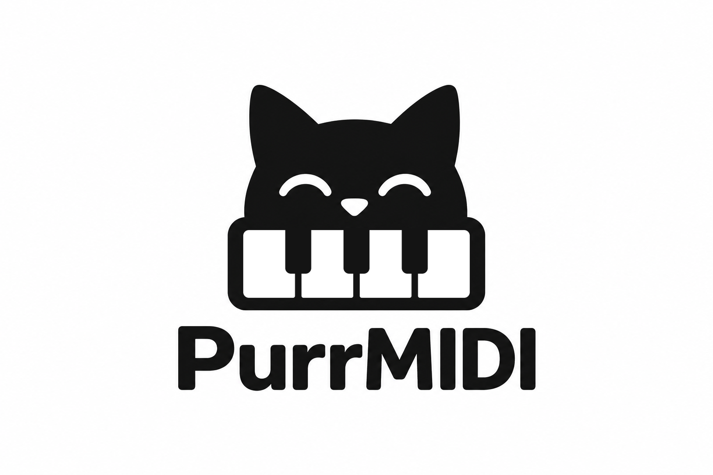
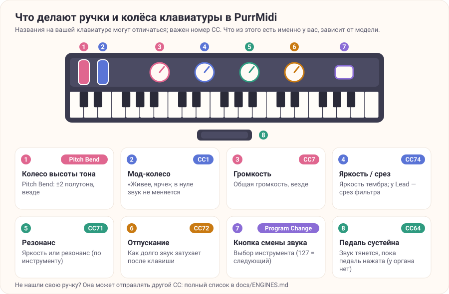

<p align="center">
  
</p>

# PurrMidi

https://purrrock.github.io/purrmidi/

[English version](README.md)

**PurrMidi** — автономный MIDI-синтезатор на базе STM32: подключаете USB MIDI-клавиатуру, звук генерирует микроконтроллер и выводит его через аудио ЦАП.

В проекте есть прошивка STM32H743, Windows-приложение для проверки звуковых движков на ПК (может работать без MIDI-клавиатуры), шесть звуковых движков (электропиано, гитара (нейлоновая струна), лид, орган, скрипка, SoundFont).
Аппаратная часть и прошивка версии 1.0.

* **[Для сборки и игры](#для-сборки-и-игры)**: что купить, как прошить плату и играть. Собирать проект из исходников и разбираться в электронике не нужно.
* **[Для разработчиков](#для-разработчиков)**: сборка из исходников, тесты, устройство прошивки.

## Для сборки и игры

Этот раздел для тех, кто хочет собрать прибор и играть. Готовая прошивка и пошаговые инструкции, компилятор не нужен.

### Аппаратное обеспечение

* **Микроконтроллер:** WeAct STM32H743VIT6 Mini (Cortex-M7).
* **Аудио ЦАП:** PCM5102A.
* **MIDI-вход:** USB MIDI-клавиатура через USB OTG.
* **Кнопка управления:** User Key K1 на плате микроконтроллера для переключения инструмента.
* **Дисплей:** на плате — статус MIDI, активные ноты, название аккорда и выбранный инструмент.
* **Карта памяти:** microSD (FAT32). Используется **только при запуске**: для автоматической записи/обновления SoundFont-банка `0:/SNDFNT.SF2` во Flash на плате. Во время игры SD-карта не используется и может быть извлечена.

Подключения и распиновка — в [docs/HARDWARE.md](docs/HARDWARE.md).

### Основы работы

**Подключение.** USB MIDI-клавиатуру подключите к USB OTG разъёму платы, аудиовыход PCM5102A — к активным колонкам или наушникам. Включите питание: запускается последний выбраный инструмент. Если первый запуск, то E-Piano.
Если для питания платы используется тот же USB разъём, что и для подключения MIDI-клавиатуры (да, так можно!), то вам понадобится Y-разветвитель.
По умолчанию при включении тихо. Чтобы проверить звук (ЦАП, перемычки, наушники или усилитель), **включите прибор, удерживая кнопку K1**: проиграет короткая приветственная мелодия.

**Выбор инструмента.** Сообщением с MIDI-клавиатуры Program Change или кнопкой **K1** на плате.

| Program Change | Инструмент | Что это |
| -------------: | ---------- | ------- |
| `0` | **E-Piano** | FM-электропиано (по умолчанию) |
| `1` | **Pluck** | Гитара (нейлоновая струна |
| `2` | **Lead** | Аналоговый синтезатор-лид |
| `3` | **Organ** | Тонколесный орган |
| `4` | **Violin** | Скрипка |
| `5…` | **SoundFont** | Пресеты банка SoundFont2: `5` — первый, `6` — второй и т. д. |
| `127` | — | Следующий инструмент по кругу (так же работает K1) |

Название инструмента и активные ноты показываются на дисплее. Выбор инструмента и громкость сохраняются и восстанавливаются после перезапуска. После отключения питания они остаются только при установленной 3V батарейке (см. [docs/HARDWARE.md](docs/HARDWARE.md#батарейка-vbat-необязательно)); без неё прибор включается с E-Piano.

**Управление с клавиатуры.** Одинаково во всех инструментах: Pitch Bend (±2 полутона), общая громкость — CC7, общая реверберация — CC91 (после включения всегда «немного», не запоминается), педаль сустейна — CC64 (кроме органа), All Sound Off — CC120, All Notes Off — CC123; мод-колесо CC1 везде значит «живее, ярче» (в нуле звук не меняется).

| Инструмент | MIDI |
| ---------- | ---- |
| E-Piano | CC71 / CC74 яркость, CC72 отпускание, CC1 добавляет яркость |
| Pluck | CC71 / CC74 яркость, CC72 затухание, CC1 (мод-колесо) добавляет яркость |
| Lead | CC74 срез фильтра, CC71 резонанс, CC1 добавляет глубину огибающей, CC73 / CC72 атака / отпускание |
| Organ | CC20–28 drawbars, CC70 хорус вкл/выкл (CC1 ≥ 64 тоже включает), CC71 / CC72 скорость / глубина хоруса, CC77 / CC78 атака / отпускание |
| Violin | CC1 добавляет вибрато, CC70 / CC71 / CC75 положение, прижим и шум смычка, aftertouch |
| SoundFont | CC1 вибрато (диапазон Pitch Bend — по RPN 0) |



Какая ручка что меняет в каждом инструменте — в [таблице контроллеров](docs/ENGINES.md#что-делают-ручки-и-колёса-вашей-клавиатуры); двигаете ручку — на дисплее появляется её название и значение. Полный список и диапазоны — в [docs/ENGINES.md](docs/ENGINES.md).

**Свой SoundFont.** Положите файл банка в корень microSD-карты под именем `SNDFNT.SF2`, вставьте карту и включите прибор: банк автоматически запишется во флеш-память (30–60 секунд, ход виден на дисплее). Дальше карта не нужна. Подробности — в [docs/SOUNDFONT.md](docs/SOUNDFONT.md).
Размер `SNDFNT.SF2` не должен превышать 8 МБ (точнее, 8 384 512 байт), иначе он не поместится во флеш-память. Уменьшить размер файла можно онлайн-инструментом на сайте проекта, раздел «Свой SoundFont» (работает в браузере, файл никуда не отправляется), скриптом `SoundFonts/sf2_shrink.py` (тот же алгоритм из командной строки) или бесплатной утилитой Polyphone.
В каталоге `SoundFonts/` лежат несколько небольших банков инструментов.

### Прошивка платы

Готовая прошивка лежит на странице [Releases](https://github.com/purrrock/purrmidi/releases/latest), собирать её самостоятельно не нужно. Прошить можно через STM32CubeProgrammer.

Можно обойтись без программатора и без установки программ: [веб-прошивальщик](https://purrrock.github.io/purrmidi/ru/flash/) записывает прошивку через USB-загрузчик платы (DFU) прямо из браузера на Chromium (WebUSB). Пошаговая инструкция с STM32CubeProgrammer — в [docs/FLASHING.md](docs/FLASHING.md).

### Документация для пользователя

| Документ | О чём |
| -------- | ----- |
| [docs/FLASHING.md](docs/FLASHING.md) | Как прошить плату, пошагово |
| [docs/HARDWARE.md](docs/HARDWARE.md) | Распиновка, подключение ЦАП (перемычки), UART, батарейка VBAT |
| [docs/ENGINES.md](docs/ENGINES.md) | Звуковые движки, Program Change, громкость, таблица контроллеров |
| [docs/FAQ.md](docs/FAQ.md) | Вопросы и ответы: нет звука, клавиатура не определяется и т. д. |
| [enclosure/](enclosure/README.md) | Корпус |

## Для разработчиков

Сборка из исходников, тесты и устройство прошивки. Термины вроде XIP, MPU, SAI и PendSV нужны только здесь и описаны в [docs/ARCHITECTURE.md](docs/ARCHITECTURE.md).

### Получение исходников

```bash
git clone https://github.com/purrrock/purrmidi
```

Всё, что нужно для сборки, лежит в самом репозитории (сторонний код — в `Middlewares/Third_Party/` и `Platform/display/st7735/`).

### Прошивка STM32 из исходников

```bash
cmake --preset Debug
cmake --build --preset Debug
```

Для релизной сборки:

```bash
cmake --preset Release
cmake --build --preset Release
```

Готовый `purrmidi.elf` каждой сборки лежит в артефакте CI `purrmidi-stm32h743-firmware`.

### Windows-версия

В Windows с установленным CMake и компилятором MSVC:

```bash
cmake --preset win-msvc-release
cmake --build --preset win-msvc-release
```

Параметры запуска, виртуальная клавиатура и тесты — в [docs/WINDOWS_BUILD.md](docs/WINDOWS_BUILD.md).

### Документация для разработчиков

| Документ | О чём |
| -------- | ----- |
| [docs/ARCHITECTURE.md](docs/ARCHITECTURE.md) | Путь MIDI-событий, DMA, память, структура репозитория, USB Host |
| [docs/SOUNDFONT.md](docs/SOUNDFONT.md) | Банк SoundFont, QSPI Flash (XIP), SD-карта, настройка CubeMX, диагностика |
| [docs/WINDOWS_BUILD.md](docs/WINDOWS_BUILD.md) | Windows-приложение и тесты |
| [ROADMAP.md](ROADMAP.md) | Планы развития |

## Лицензии

* **Сторонние компоненты.** В проекте используются HAL/CMSIS, USB Host Library (ST), FatFs, TinySoundFont, часть DaisySP (`Oscillator`, `Svf`, `Adsr`), bfreeOrgan2 и другие. Полный перечень, лицензии и условия — в [`THIRD_PARTY_NOTICES.md`](THIRD_PARTY_NOTICES.md).
* **Лицензия собственного кода PurrMidi — MIT** (файл [`LICENSE`](LICENSE)).
