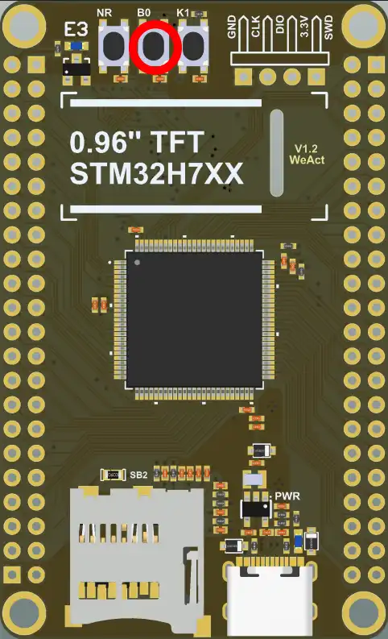
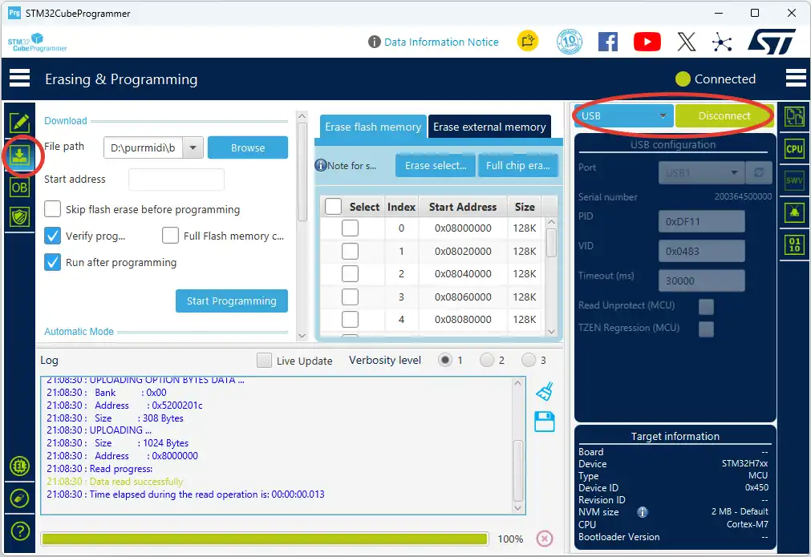

# Прошивка платы

Как загрузить готовую прошивку PurrMIDI в плату **WeAct STM32H743 Mini**. Собирать проект самостоятельно не нужно: готовый файл лежит на странице [Releases](https://github.com/purrrock/purrmidi/releases/latest).

Вам понадобится:

* плата WeAct STM32H743 Mini;
* кабель USB-C **для передачи данных** (кабели «только для зарядки» не подойдут);
* компьютер с Windows, Linux или macOS;
* бесплатная программа [STM32CubeProgrammer](https://www.st.com/en/development-tools/stm32cubeprog.html) от ST (нужна регистрация на сайте ST).

Отдельный программатор (ST-Link) не нужен: в микроконтроллер встроен USB-загрузчик (DFU).

Инструкция проверена на реальной плате (прошивка по USB DFU).

## 1. Скачайте прошивку

На странице [Releases](https://github.com/purrrock/purrmidi/releases/latest) скачайте файл **`purrmidi.elf`**.

В `.elf` уже записан адрес загрузки (`0x08000000`), поэтому вводить его вручную не нужно.

Если хотите убедиться, что файл скачался без повреждений, скачайте также `SHA256SUMS` и сверьте сумму:

* Linux / macOS: `sha256sum -c SHA256SUMS` (на macOS — `shasum -a 256 -c SHA256SUMS`);
* Windows (PowerShell): `Get-FileHash purrmidi.elf -Algorithm SHA256` и сравните результат со строкой в `SHA256SUMS`.

## 2. Подготовьте плату

1. **Отключите от платы USB MIDI-клавиатуру.** USB-разъём платы используется и для клавиатуры, и для прошивки.
2. Отключите от платы питание, если оно подключено отдельно. Для прошивки плата питается от компьютера по USB.

## 3. Переведите плату в режим загрузчика

На плате три кнопки: **NRST** (сброс), **BOOT0** и **K1**. Сделайте так:

1. **Зажмите BOOT0** и удерживайте.
2. Подключите плату кабелем к компьютеру.
3. Отпустите **BOOT0**.

Плата перешла в режим загрузчика: дисплей остаётся тёмным или пустым, а компьютер видит новое USB-устройство **STM32 BOOTLOADER**.

Кнопки находятся у верхнего края платы, над дисплеем. На плате они подписаны **NR** (NRST), **B0** (BOOT0) и **K1**. Нужная вам кнопка **B0** — средняя, на фото она обведена красным:

## 4. Загрузите прошивку

1. Запустите **STM32CubeProgrammer**.
2. В правом верхнем углу выберите способ подключения **USB** и нажмите **Connect**. В поле порта должно появиться устройство вида `USB1`. Если оно не появилось, нажмите кнопку обновления рядом с полем порта.
3. Откройте вкладку **Erasing & Programming** (значок «Download» в левом меню).
4. В поле **File path** выберите `purrmidi.elf`.
5. Нажмите **Start Programming**.
6. Дождитесь сообщения **File download complete**.

На скриншоте красным обведены значок вкладки **Erasing & Programming** в левом меню, а также способ подключения **USB** и кнопка **Connect** (после подключения она меняется на **Disconnect**). Остальные параметры можно оставить по умолчанию: галочки **Verify programming** (проверка записи) и **Run after programming** (запуск сразу после записи) лучше оставить включёнными.

## 5. Запустите прибор

1. Нажмите **Disconnect** в программе и отключите кабель.
2. Убедитесь, что кнопка BOOT0 отпущена.
3. Подключите плату к питанию (или нажмите NRST).

При включении на дисплее около секунды показывается **заставка с логотипом PurrMIDI и номером версии прошивки** (например, `v1.0.2`), затем дисплей переключается на рабочий экран. Сравните номер на заставке с номером релиза, который вы скачали: если они разные, прошивка не обновилась, повторите шаги 3 и 4.

По умолчанию при включении тихо. Чтобы проверить звук (ЦАП, перемычки, наушники или усилитель), **включите прибор, удерживая кнопку K1**: заставка останется на экране, пока играет короткая приветственная мелодия (около двух секунд). Звучит она текущим инструментом и с сохранённой громкостью. Кнопку K1 можно отпускать, когда заставка появилась. См. фото в шаге 3: K1 справа от B0.

Версию можно узнать и по UART (`115200, 8N1`): первая строка при включении выглядит так: `[SYS] PurrMIDI firmware v1.0.2`.

Дальше подключите ЦАП и клавиатуру, как описано в [HARDWARE.md](HARDWARE.md). Свой звуковой банк можно записать по инструкции в [SOUNDFONT.md](SOUNDFONT.md); готовый `SNDFNT.SF2` лежит в том же релизе.

## Если что-то не получается

| Проблема | Что проверить |
| -------- | ------------- |
| Компьютер не видит устройство «STM32 BOOTLOADER» | Используйте кабель с передачей данных и другой USB-порт компьютера. Повторите вход в режим загрузчика: BOOT0 нужно держать **до и во время** подключения платы к компьютеру. |
| В диспетчере устройств Windows неизвестное устройство | Установите STM32CubeProgrammer (вместе с ним ставится драйвер DFU), затем снова войдите в режим загрузчика. |
| Linux: программа не видит устройство | Запустите STM32CubeProgrammer от имени администратора или установите правила udev, которые лежат в папке установки программы. |
| В списке портов нет `USB1` | Нажмите кнопку обновления рядом с полем порта, при необходимости выберите **Connect** ещё раз. |
| Ошибка при загрузке | Повторите вход в режим загрузчика и загрузите файл ещё раз. Используйте короткий кабель, без USB-хаба. |
| Заставка появляется, а мелодии не слышно | Мелодия играет только если K1 была зажата в момент включения питания. Включите прибор, удерживая K1. Если всё равно тихо, проверьте подключение и перемычки ЦАП, наушники или усилитель, см. [HARDWARE.md](HARDWARE.md); громкость берётся из сохранённых настроек, возможно, она убавлена. |
| После прошивки экран тёмный | Убедитесь, что BOOT0 отпущена, и нажмите NRST. Если не помогло, расскажите о проблеме в [Issues](https://github.com/purrrock/purrmidi/issues/new/choose). |

Остальные вопросы — в [FAQ.md](FAQ.md).

## Другие способы прошивки

Для тех, у кого есть опыт или программатор.

* **ST-Link (SWD).** В STM32CubeProgrammer выберите подключение **ST-LINK**, откройте `purrmidi.elf` и загрузите его так же, как в шаге 4. BOOT0 при этом трогать не нужно.
* **dfu-util.** Утилита принимает не `.elf`, а двоичный файл, поэтому понадобится `purrmidi.bin`. Его можно взять из артефактов CI (`purrmidi-stm32h743-firmware`) или получить командой `arm-none-eabi-objcopy -O binary purrmidi.elf purrmidi.bin`. Затем, когда плата в режиме загрузчика: `dfu-util -a 0 -s 0x08000000:leave -D purrmidi.bin`.
* **OpenOCD.** См. `tools/openocd-run.cmd` в репозитории.
* **Сборка из исходников.** См. раздел «Сборка» в [README](../README_RU.md).
